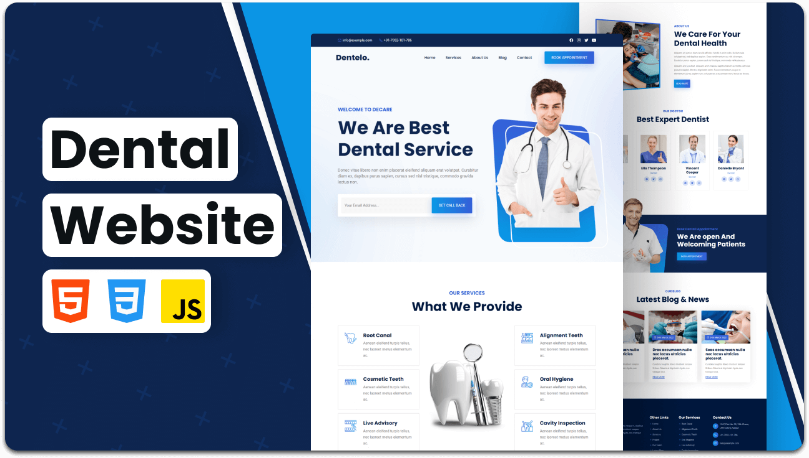

# 🦷 Royal Pearl - Premium Dental Clinic Website

[](#)
[](#)
[](#)

A modern, responsive, and patient-centered dental clinic website designed for **Royal Pearl Dental Clinic**. Built with clean HTML5, custom CSS3, and modern JavaScript, this platform provides seamless patient experiences, detailed dental treatment descriptions, expert dentist profiles, oral healthcare blogs, and convenient multi-channel appointment booking.

---

## 📸 Preview



---

## 🌟 Key Features

### 1. 🏥 Modern & Responsive Design
- Clean, clinical, and reassuring aesthetics using a curated blue palette (`--carolina-blue`, `--royal-blue-light`, `--oxford-blue`).
- Fully responsive across smartphones, tablets, laptops, and desktop screens with custom CSS breakpoints.
- Interactive sticky header with automatic elevation upon scrolling and back-to-top navigation.
- Smooth mobile drawer navigation toggler for small screens.

### 2. 🦷 Comprehensive Dental Services
Detailed service cards outlining preventive, restorative, and aesthetic procedures:
- **Root Canal:** Safe, pain-free endodontic therapy preserving natural tooth structure.
- **Teeth Alignment:** Clear aligners and orthodontic treatments for healthy, aligned teeth.
- **Cosmetic Dentistry:** Porcelain veneers, smile makeovers, and professional whitening.
- **Oral Hygiene:** Deep scaling, plaque removal, and periodontal wellness care.
- **Live Advisory:** Real-time dental consultations and virtual specialist second opinions.
- **Cavity Inspection:** Digital radiography and high-precision diagnostic screenings.

### 3. 👨‍⚕️ Expert Doctors & Surgeons
- Profiles of specialist dentists including **Dr. Ritika Sharma** (Senior Dental Surgeon), **Dr. Howard Holmes** (Endodontist Specialist), **Dr. Gaurav Tripathi** (Chief Implantologist), and **Dr. Supriya Verma** (Orthodontist & Cosmetic Dentist).
- Specialist designations, photo cards, and social links.

### 4. 📅 Multi-Channel Appointment Booking & Contact
- **Instant WhatsApp Booking:** Direct pre-filled WhatsApp consultation link for frictionless scheduling.
- **Call-Back Request:** Email capture in the hero banner for quick phone consultations.
- **Primary & Alternative Phone Numbers:** Dedicated lines for appointments and emergency support.
- **Dual Email Inboxes:** Dedicated general inquiry and patient support email channels.

### 5. 📚 Oral Health Educational Blog
- Patient-friendly dental health tips covering proper brushing/flossing techniques, nutritional advice for strong enamel, and routine check-up schedules.

### 6. 💬 Live Patient Chat
- Integrated Drift live chat snippet for real-time patient support and instant answers.

---

## 📞 Clinic & Contact Information

| Detail | Primary Information | Alternative / Backup Detail |
| :--- | :--- | :--- |
| **Brand Name** | **Royal Pearl Dental Clinic** | Royal Pearl Dental Care |
| **Primary Phone** | `+91 98765 43210` | `+91 98765 43211` *(Helpline / Emergency)* |
| **WhatsApp Booking** | `+91 98765 43210` | [Book via WhatsApp](https://wa.me/919876543210) |
| **Email Address** | `info@royalpearldental.com` | `support@royalpearldental.com` *(Appointments)* |
| **Clinic Address** | Royal Pearl Clinic, Civil Lines, Bhadohi, Uttar Pradesh - 221314, India | |
| **Working Hours** | **Monday – Saturday:** 9:00 AM – 9:00 PM | **Sunday:** 10:00 AM – 2:00 PM *(By Appointment)* |

---

## 🛠️ Technology Stack

- **Markup:** HTML5 (Semantic tags: `<header>`, `<nav>`, `<main>`, `<section>`, `<article>`, `<footer>`)
- **Styling:** Vanilla CSS3 (CSS Custom Properties, Flexbox, CSS Grid, animations, and media queries)
- **Scripting:** Modern JavaScript (ES6+ for mobile navigation, scroll listener, and active header state)
- **Icons:** [Ionicons 5.5.2](https://ionic.io/ionicons)
- **Typography:** [Google Fonts](https://fonts.google.com/) (`Poppins` and `Roboto`)
- **Live Chat:** [Drift Chatbot](https://www.drift.com/)

---

## 📁 Project Structure

```text
Royal-Pearl/
├── assets/
│   ├── css/
│   │   └── style.css            # Custom responsive stylesheet & design system
│   ├── images/                  # Banners, service icons, doctor photos & assets
│   │   ├── BLOG.gif
│   │   ├── bb.gif
│   │   ├── doc.jpg
│   │   ├── doc1.jpeg
│   │   ├── doc3.jpeg
│   │   ├── kl.gif
│   │   ├── o.jpg
│   │   ├── po.gif
│   │   ├── service-banner.png
│   │   └── service-icon-*.png
│   └── js/
│       └── script.js            # Navigation drawer & scroll behavior
├── readme-images/
│   └── desktop.png              # Website desktop screenshot
├── favicon.svg                  # Dental tooth SVG favicon
├── index.html                   # Main landing page
├── index.txt                    # Project content reference
├── style-guide.md               # CSS design tokens & color reference
└── README.md                    # Project documentation
```

---

## 🚀 Getting Started

Follow these steps to run the website locally:

### Option 1: Direct File Open
Simply double-click `index.html` or open it with your web browser (Chrome, Firefox, Edge, Safari).

### Option 2: Live Server (VS Code / IDE)
1. Open the `Royal-Pearl` folder in VS Code or your preferred IDE.
2. Right-click on `index.html` and select **"Open with Live Server"**.
3. The site will launch automatically at `http://localhost:5500`.

### Option 3: Local Python HTTP Server
```bash
# In the project directory:
python -m http.server 8000
```
Then visit `http://localhost:8000` in your web browser.

---

## 📱 Responsive Breakpoints

| Breakpoint | Target Devices |
| :--- | :--- |
| **< 575px** | Mobile phones (single-column layout, drawer menu) |
| **≥ 575px** | Larger mobile devices & small phablets |
| **≥ 768px** | Tablets & small laptops (2-column grids, expanded hero) |
| **≥ 992px** | Desktop & large tablets (top contact bar, horizontal navbar) |
| **≥ 1200px** | High-resolution monitors (3-column service grid, wide container) |

---

## 📄 License

This project is open-source and available for educational and commercial clinic presentation purposes.

&copy; 2026 **Royal Pearl Dental Clinic**. All Rights Reserved.
